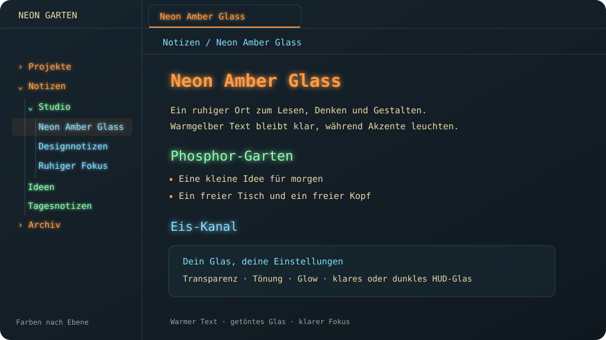

# Neon Amber Glass

[Deutsch](README.de.md) · [English](README.md)

Ein dunkles Glas-Theme mit warmgelbem Lesetext und leuchtenden Akzenten in Orange, Grün und Eis-Hellblau. Gut lesbare Terminal-Schrift, ohne Flackern oder animierte Effekte.

## Funktionen

- Sanft gelber Fließtext. Nur Überschriften, Titel und Dateinamen leuchten.
- Orange für H1/H4, Grün für H2/H5 und Eis-Hellblau für H3/H6.
- Die Navigation wird standardmäßig nach Tiefe gefärbt. Alle Einträge auf derselben Ebene haben dieselbe Farbe, auch in verschiedenen Ordnern. Die drei Farben wiederholen sich auf tieferen Ebenen.
- Wahlweise wechselnde Farben für einzelne Navigationseinträge.
- Einstellbare Hintergrund-Transparenz, Farbsättigung der Tönung, Leuchtstärke, Zeilenhöhe und Textbreite.
- Die Stärke der Tönung verändert die Farbsättigung bei gleichbleibender wahrgenommener Helligkeit.
- Bei Transparenz 100 sind alle Hintergrundflächen vollständig durchsichtig, einschließlich der zusätzlichen Notiz-Abdunklung. Text bleibt deckend.
- Die Farbfelder zeigen den tatsächlich gewählten Farbton.
- Optionale statische Scanlines, ein blickdichter Lesemodus, Unterstützung für reduzierte Transparenz und eine klare Druckansicht.

Die Vorschau illustriert die Standardfarben mit erfundenen Beispielinhalten. Sie enthält keine persönlichen Vault-Daten.

## Installation

Öffne den [Community-Eintrag](https://community.obsidian.md/themes/neon-amber-glass) oder suche das Theme unter **Einstellungen → Darstellung → Themes → Verwalten**. Bei neuen Versionen muss gegebenenfalls erst die Prüfung im Verzeichnis abgeschlossen werden, bevor die Installation freigegeben ist.

Für eine manuelle Installation lade `manifest.json` und `theme.css` aus dem [neuesten Release](https://github.com/khedrub/neon-amber-glass/releases/latest) herunter. Lege beide Dateien in `<Vault>/.obsidian/themes/Neon Amber Glass/` ab und wähle **Neon Amber Glass** unter **Einstellungen → Darstellung** aus.

Installiere und aktiviere [Style Settings](https://github.com/community-archive/obsidian-style-settings), um die Regler unter **Einstellungen → Style Settings → Neon Amber Glass** zu verwenden. Ohne dieses Plugin gelten dieselben Standardwerte, einschließlich der Navigationsfarben nach Ebene.

**Navigation nach Ebene färben** ist standardmäßig aktiviert. Schalte es aus, wenn die Farben pro Eintrag wechseln sollen.

## Sprache

Alle Theme-Überschriften, Beschreibungen und Namen der Theme-Umschaltbefehle folgen der Obsidian-Sprache: Deutsch oder Englisch. Für andere Sprachen wird Englisch verwendet. Ändere die Sprache unter **Einstellungen → Allgemein → Sprache** und starte Obsidian neu, wenn du dazu aufgefordert wirst. Die Einstellungs-IDs bleiben gleich; deine Werte bleiben beim Sprachwechsel erhalten.

Der Companion übersetzt zusätzlich die Optionen der Auswahl **Fensterglas**, Standardwert-Anzeigen und Umschaltbefehle. Er korrigiert auch ältere Style-Settings-Versionen, deren Sprache von Obsidian abweicht. Ohne Companion werden die zwei Materialnamen in beiden Sprachen angezeigt, da Style Settings Dropdown-Optionen selbst nicht übersetzt. Der native Materialwechsel benötigt den Companion auf macOS.

Anleitung und illustrierte Vorschau stehen in beiden Sprachen zur Verfügung. Produktnamen wie Neon Amber Glass, Style Settings und HUD bleiben unverändert.

## Schriften

Es werden nur lokale Schriften verwendet: Monaco, Menlo, JetBrains Mono, Consolas oder die Monospace-Schrift des Systems. Deine Obsidian-Schrifteinstellungen haben Vorrang. Keine Schrift-Downloads und keine mitgelieferten proprietären Schriften.

## Glas und native Transparenz

Die CSS-Transparenz gilt für Hintergrundflächen, nicht für das gesamte Fenster. Native Desktop-Durchsicht benötigt eine unterstützte Desktop-Plattform und ein mit Transparenz gestartetes Fenster. Aktiviere auf macOS Obsidians Einstellung **Transparenzeffekt** (englisch: **Translucent window**).

Der optionale [Neon Amber Glass Companion](https://github.com/khedrub/neon-amber-glass-companion) wählt klares oder dunkles HUD-Fenstermaterial auf macOS. Der entsprechende Style-Settings-Regler heißt **Fensterglas**.

Einige Obsidian-/Electron-Installationen erzeugen trotz aktivierter Durchscheinend-Einstellung ein blickdichtes Fenster. Ein Theme oder Materialwechsel kann diesen Startparameter nicht korrigieren. Echte Desktop-Durchsicht ist deshalb von einem transparent gestarteten Fenster abhängig. Weder das Theme noch der Companion verändert Obsidian-Anwendungsdateien oder wendet einen Start-Patch an.

**Blur hinter Popups** steuert den CSS-Blur hinter Menüs und Popups innerhalb der App. macOS bestimmt die Stärke des nativen Desktop-Blurs; dafür gibt es keinen stufenlosen Pixel-Regler.

Auf anderen Plattformen behält das Theme seine dunkle Darstellung. Transparente Flächen über hellen Inhalten können den Kontrast verringern. Verwende zusätzliche Notiz-Abdunklung oder **Blickdichter Lesemodus** für eine deckende Lesefläche.

## Kompatibilität

Getestet mit Obsidian 1.14.4 auf macOS und Installer 1.13.7. Das Theme verwendet moderne Chromium-CSS-Funktionen, darunter relative OKLCH-Farben, `color-mix()` und `mod()`. Verwende Installer 1.13.7 oder neuer. Ein Update nur des Obsidian-App-Pakets kann eine ältere Chromium-Laufzeit beibehalten.

Unterstützt wird der dunkle Darstellungsmodus. Das Theme bleibt auch bei heller Systemdarstellung dunkel.

Keine Ressourcen aus dem Netzwerk, keine Telemetrie und kein Zugriff auf Notizen.

## Lizenz

[MIT](LICENSE), © 2026 khedrub. Eine [deutsche Übersetzung](LICENSE.de.md) ist ebenfalls enthalten.
