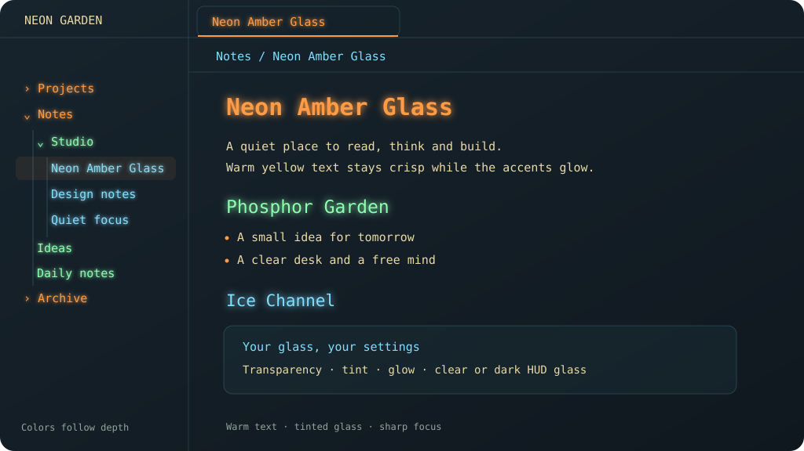

# Neon Amber Glass

[English](README.md) · [Deutsch](README.de.md)

A dark glass theme with warm yellow text and glowing orange, green and ice-blue accents. Readable terminal typography, without flicker or animated effects.

## Features

- Soft yellow body text. Glow is reserved for headings, titles and file names.
- Orange H1/H4, green H2/H5 and ice-blue H3/H6 headings.
- Navigation colors follow folder depth by default. Every item at the same level gets the same color, across different folders. The three colors repeat at deeper levels.
- Optional alternating colors for individual navigation entries.
- Adjustable background transparency, tint saturation, glow, line height and readable width.
- Tint strength changes chroma at a constant perceptual lightness.
- Fully transparent background surfaces at 100%, including the extra note shading. Text remains opaque.
- Color-picker swatches show the actual selected colors.
- Optional static scanlines, an opaque reading mode, reduced-transparency support and a clean print layout.

The preview illustrates the default palette with synthetic demo content. It contains no personal vault data.

## Install

Open the [community listing](https://community.obsidian.md/themes/neon-amber-glass) or find the theme under **Settings → Appearance → Themes → Manage**. New releases may need to complete the directory review before installation is enabled.

For manual installation, download `manifest.json` and `theme.css` from the [latest release](https://github.com/khedrub/neon-amber-glass/releases/latest), put both files in `<vault>/.obsidian/themes/Neon Amber Glass/`, and select **Neon Amber Glass** in **Settings → Appearance**.

Install and enable [Style Settings](https://github.com/community-archive/obsidian-style-settings) to use the controls in **Settings → Style Settings → Neon Amber Glass**. Without it, the theme uses the same defaults, including navigation colors by depth.

**Color navigation by depth** is enabled by default. Turn it off for the alternating-entry palette.

## Language

All theme setting titles, descriptions and theme toggle command names follow Obsidian's language: German or English, with English as the fallback for other languages. Change the language under **Settings → General → Language** and restart Obsidian when prompted. The setting IDs stay the same, so changing language preserves your values.

The companion also translates the **Window glass** dropdown, default-value labels and toggle commands, and corrects older Style Settings versions that use a different language from Obsidian. Without the companion, the two material names are shown in both languages because Style Settings does not translate dropdown options itself. Native material switching requires the companion on macOS.

Documentation and illustrated previews are available in both languages. Product names such as Neon Amber Glass, Style Settings and HUD are unchanged.

Local fonts only: Monaco, Menlo, JetBrains Mono, Consolas or the system monospace fallback. Your Obsidian font preferences take precedence. No font downloads or bundled proprietary fonts.

## Glass and native transparency

CSS transparency applies to background surfaces, not to the entire window. Native desktop transparency requires a supported desktop platform and a window created with transparency enabled. On macOS, enable Obsidian's **Translucent window** setting.

The optional [Neon Amber Glass Companion](https://github.com/khedrub/neon-amber-glass-companion) selects clear or dark HUD window material on macOS. **Window glass** is the corresponding Style Settings control.

Some Obsidian/Electron installations create an opaque window even when translucency is enabled. A theme or a material switch cannot repair that window-creation flag. True desktop sampling is conditional on a transparent window. Neither this theme nor the companion modifies Obsidian application files or applies a startup patch.

**Blur behind popups** controls CSS blur behind in-app menus and popups. macOS controls the strength of native desktop blur; it is not a continuous pixel slider.

On unsupported platforms, the theme keeps its dark appearance. Transparent backgrounds over bright content can reduce contrast; use extra note shading or **Opaque reading mode** for an opaque reading surface.

## Compatibility

Tested with Obsidian 1.14.4 on macOS using installer 1.13.7. The theme uses modern Chromium CSS, including relative OKLCH colors, `color-mix()` and `mod()`. Use installer 1.13.7 or newer; updating only the Obsidian app package may leave an older Chromium renderer in place.

Dark mode is the supported visual mode. The theme remains dark when selected under a light system appearance.

No network assets, telemetry or note access.

## License

[MIT](LICENSE), © 2026 khedrub. A [German translation](LICENSE.de.md) is included for convenience.
